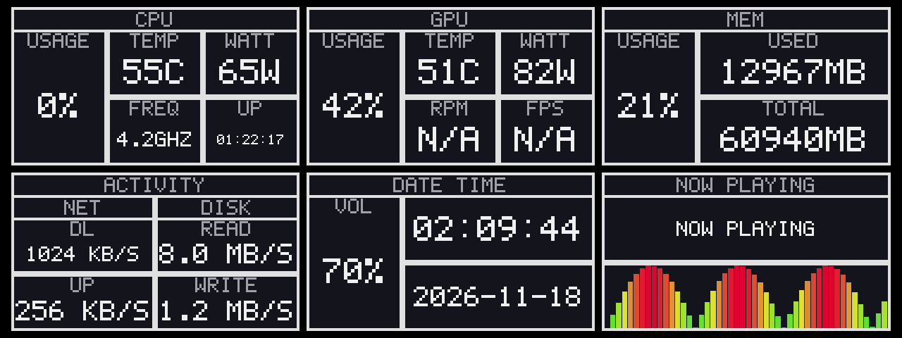
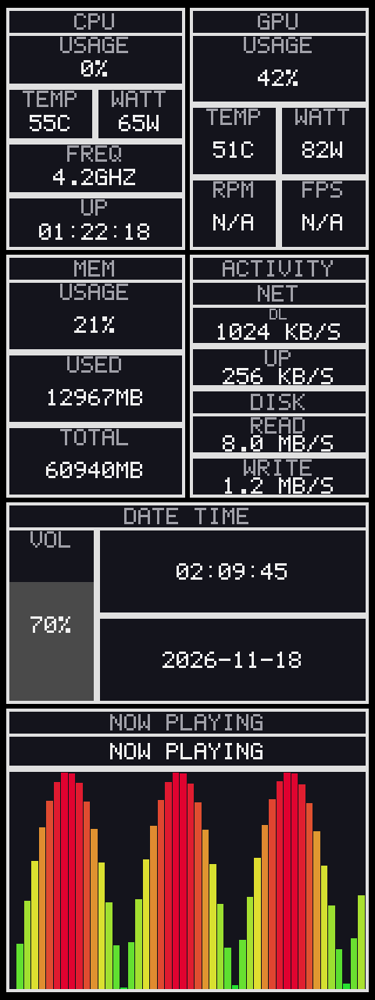

# trofeo_lcd

**Bahasa Indonesia** · [English](./README.md)

**Alternatif ringan dan open-source untuk software resmi Thermalright TRCC.**
Proyek ini menggunakan **LCD Thermalright 6 inci**, resolusi **1280×480**,
USB HID `0416:5302`. Layar Trofeo Vision 9,16 inci terdahulu
(1920×462, USB bulk LY `0416:5408` / `0416:5409`) juga didukung.
Protokol USB mengacu pada [thermalright-trcc-linux](https://github.com/Lexonight1/thermalright-trcc-linux).

**Tampilan default adalah dashboard grid** yang memadatkan semua info dalam
panel sekaligus — CPU, GPU, RAM, aktivitas jaringan & disk, jam/tanggal/
volume dan visualizer now-playing. Layar terisi penuh di kedua orientasi:

**Landscape** (`--rotate 0` atau `180`, 1280×480):



**Portrait** (`--rotate 90` atau `270`, 480×1280):



Tambahkan **`--classic`** untuk memakai tampilan adaptif lama — layar
**menyesuaikan otomatis dengan kondisi komputer**, tanpa perlu ganti mode
manual:

**Idle** — audio sedang tenang, jadi bar EQ rendah dan baris atas
menampilkan info sistem: usage & frekuensi real-time CPU, RAM, uptime, jam
dan tanggal.


**Media** — sedang ada lagu diputar: bar mengikuti musik, dan baris atas
menampilkan lagu yang sedang jalan (judul/artis/album dari kontrol media).


**Gaming** — ada game di foreground: info game terdeteksi dan status sistem
(CPU/GPU/RAM/temp) tetap terbaca selagi bermain.


## Fitur

- **Dashboard grid** (default): panel CPU, GPU, RAM, aktivitas jaringan/
  disk, jam/tanggal/volume dan now-playing, landscape atau portrait
  (`--rotate`).
- Bar EQ (48 bar) dari audio yang sedang diputar (WASAPI loopback di
  Windows, PulseAudio/PipeWire di Linux, Core Audio process tap di macOS),
  warna hijau→kuning→merah.
- Info sistem: CPU %, frekuensi CPU real-time, RAM, uptime, jam & tanggal.
- **Gambar background** opsional (`--background`), dengan warna tulisan
  dipilih per baris supaya tetap terbaca di atas foto yang terang.
- Bisa sekaligus menyalakan display **DeepCool** (kirim data CPU via HID).
- **Mode second monitor** (`trofeo_screen`): LCD jadi monitor sekunder asli.
- Sinkron warna bar EQ dengan device **OpenRGB**.
- FPS adaptif: turun ke idle saat diam → hemat CPU.

## Cara pakai

```bash
cargo build --release
./target/release/trofeo_lcd          # Windows: .\target\release\trofeo_lcd.exe
```

**Windows** — untuk membaca suhu/power CPU AMD, install
[PawnIO](https://github.com/namazso/PawnIO) dan jalankan sebagai
Administrator.

**Linux** — jalankan `sudo bash scripts/root-setup.sh` untuk aturan USB dan
dependensi build Debian/Ubuntu. Gunakan `playerctl` untuk judul lagu. Tambahkan
`--rapl` untuk memberi pengguna sudo akses baca daya CPU melalui grup
`trofeo-rapl`, lalu login kembali. Tanpa akses sensor, panel menampilkan `N/A`.

**macOS** — tidak perlu install apa pun: audio sistem diambil dari Core Audio
process tap (native sejak 14.2, tanpa driver virtual dan tanpa dialog izin).
Jalankan sebagai `root` hanya jika mau power CPU + frekuensi real-time;
tanpa itu dua field itu tampil `N/A` dan sisanya tetap jalan normal.

## Profil dan konfigurasi

`trofeo_lcd` membaca `$XDG_CONFIG_HOME/trofeo-lcd/config.json` (default
`~/.config/trofeo-lcd/config.json`) di Linux/macOS atau
`%APPDATA%/trofeo-lcd/config.json` di Windows. Semua kolom opsional.
Opsi CLI mengesampingkan nilai dari file. Nilai lain mengikuti profil.

| Profil | Tema | Audio | FPS diam / aktif |
|---|---|---|---|
| `grid` (default) | `standard` | aktif | 2 / 15 |
| `inference` | `terminal` | nonaktif | 3 / 15 |
| `classic` | `standard` | aktif | 2 / 15 |

[Pratinjau inference landscape](img/inference_landscape.png) · [Portrait](img/inference_portrait.png)

| Kunci JSON | Nilai yang diterima | Fungsi |
|---|---|---|
| `profile` | `"grid"`, `"inference"`, `"classic"` | Pilih grid metrik sistem, dasbor InferRig, atau tampilan adaptif EQ, jam dan gim. |
| `theme` | `"standard"`, `"terminal"` | Gunakan aksen netral atau hijau untuk bingkai dan nilai pada dasbor. |
| `idle_fps` | Angka lebih dari 0 | Target FPS saat hening atau ketika penangkapan audio dinonaktifkan. |
| `active_fps` | Angka lebih dari 0 | Target FPS ketika penangkapan audio mendeteksi suara. |
| `audio` | `true`, `false` | Aktifkan atau nonaktifkan penangkapan audio sistem. |
| `inferrig_url` | String URL | Alamat dasar API InferRig untuk profil `inference`. Nilai bawaan `http://127.0.0.1:5577`. |
| `net_peak_half_life_secs` | Angka ≥ 0, dalam detik | Pada profil `inference`, nilai puncak laju jaringan turun menjadi separuh dalam interval ini. Nilai bawaan 2. Gunakan 0 untuk menampilkan laju transfer saat ini. |

Kunci yang tidak dikenal menyebabkan kesalahan konfigurasi. Untuk memakai semua nilai bawaan InferRig, cukup isi file dengan `{"profile": "inference"}`.

Contoh konfigurasi untuk layar InferRig:

```json
{
  "profile": "inference",
  "theme": "terminal",
  "idle_fps": 3,
  "active_fps": 15,
  "audio": false,
  "inferrig_url": "http://127.0.0.1:5577",
  "net_peak_half_life_secs": 2
}
```

Jalankan `trofeo_lcd --config examples/inference.json` untuk mencoba contoh ini,
atau salin file ke lokasi konfigurasi pengguna. Unit systemd memakai konfigurasi
pengguna dan program yang dipasang lewat `cargo install --locked --path .`.

## Opsi utama

| Opsi | Fungsi | Default |
|---|---|---|
| `--config <PATH>` | Baca konfigurasi dasbor dari file JSON ini | lokasi konfigurasi pengguna di atas |
| `--profile <NAMA>` | Pilih `grid`, `inference` atau `classic` | `grid` |
| `--theme <NAMA>` | Pilih `standard` atau `terminal` | mengikuti profil |
| `--idle-fps <N>` / `--active-fps <N>` | Target FPS saat hening / ada suara | mengikuti profil |
| `--silence-threshold <N>` | Ambang amplitudo puncak untuk mendeteksi hening | `0.005` |
| `--silence-timeout-ms <N>` | Durasi hening sebelum beralih ke FPS diam, dalam milidetik | `800` |
| `--color <MODE>` | Atur warna aksen dengan nama warna, `#RRGGBB` atau `R,G,B` | `default` |
| `--openrgb-poll-ms <N>` | Interval pembacaan warna OpenRGB dalam milidetik | `300` |
| `--audio` / `--no-audio` | Aktifkan / nonaktifkan penangkapan audio | mengikuti profil |
| `--inferrig-url <URL>` | Alamat dasar API InferRig untuk profil `inference` | `http://127.0.0.1:5577` |
| `--no-inferrig` | Sembunyikan panel AI dan bagi ruangnya ke panel sistem | panel aktif di profil `inference` |
| `--hid-rotate <DERAJAT>` | Atur rotasi pengiriman gambar ke panel HID (0/90/180/270) | dari handshake |
| `--background <PATH>` | Tampilkan gambar PNG/BMP/JPEG di belakang tulisan (dipotong sesuai ukuran layar) | nonaktif |
| `--background-dim <0-100>` | Redupkan gambar itu sekali saat dimuat agar tulisan tetap terbaca — gratis, nol biaya per frame | `15` |
| `--rotate <DERAJAT>` | Putar layar: 0, 90, 180 atau 270 | `0` |
| `--classic` | Pakai tampilan adaptif lama (bar EQ / jam idle / dashboard game) sebagai ganti dashboard grid | dashboard grid |
| `--no-deepcool` | Matikan integrasi DeepCool | aktif |
| `--deepcool-update-ms` | Interval kirim data DeepCool (100–2000 ms) | `1000` |
| `--openrgb-device <NAMA>` | Sinkron warna dengan device OpenRGB | nonaktif |
| `--hide-console` | Sembunyikan jendela terminal (Windows) | nonaktif |
| `-h, --help` | Tampilkan bantuan CLI | — |
| `-k, --screenshot-key` | Global hotkey untuk menyimpan frame LCD sebagai tangkapan layar — **PNG lossless** (dikompres deflate, tetap identik piksel; layar flat ~10 KB, bukan 2,6 MB raw) (f1-f12, printscreen) | off |

## Mode second monitor

Jalankan **`trofeo_screen`** (bukan `trofeo_lcd` — sama-sama pakai LCD, tak
boleh bersamaan):

```bash
./target/release/trofeo_screen --list-displays   # cek monitor
./target/release/trofeo_screen                   # stream ke LCD
```

Butuh *Virtual Display Driver* (VDD) sesuai resolusi LCD (1280×480 untuk layar 6 inci) — lihat
**[GUIDE_SECOND_MONITOR.id.md](./GUIDE_SECOND_MONITOR.id.md)**.

## Struktur

- `src/lib.rs` — driver USB: handshake, chunking, JPEG encode, `Framebuffer`.
- `src/audio.rs` — capture audio (WASAPI / PulseAudio-PipeWire / Core Audio tap).
- `src/cpu_sensor.rs`, `src/cpu_freq.rs` — suhu/power & frekuensi CPU.
- `src/deepcool/` — driver display DeepCool (HID).
- `src/dxgi_capture.rs` + `src/bin/screen.rs` — mode second monitor.
- `src/background.rs` — decode gambar background, redupkan & kontras teks.
- `src/jpeg_decode.rs` — decoder JPEG (baseline + progressive), ditulis dari
  nol supaya tidak perlu menarik crate `image`.
- `src/main.rs` — loop utama: audio → FFT → bar EQ → kirim ke layar.
- `src/audio_macos.rs`, `src/smc_macos.rs`, `src/amd_pm_macos.rs`,
  `src/amd_gpu_macos.rs` — backend macOS (volume ada di `src/media.rs`,
  network/disk di `src/netdisk.rs`).

## Performa

Diukur pada PC Windows (12 logical processor), `trofeo_lcd` berjalan dengan
pengaturan default (idle FPS 2 / aktif 15, DeepCool aktif):

| Metrik | Hasil ukur |
|---|---|
| RAM | ~13 MB working set (stabil, tidak membesar) |

Ringannya ini berkat FPS adaptif (JPEG-encode + kirim USB hanya terjadi saat
ada audio) dan optimasi CPU di `src/main.rs` / `src/lib.rs`.

## Lisensi

GPL-3.0-or-later (mengikuti proyek upstream rujukan).