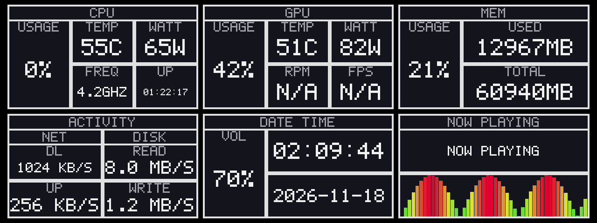
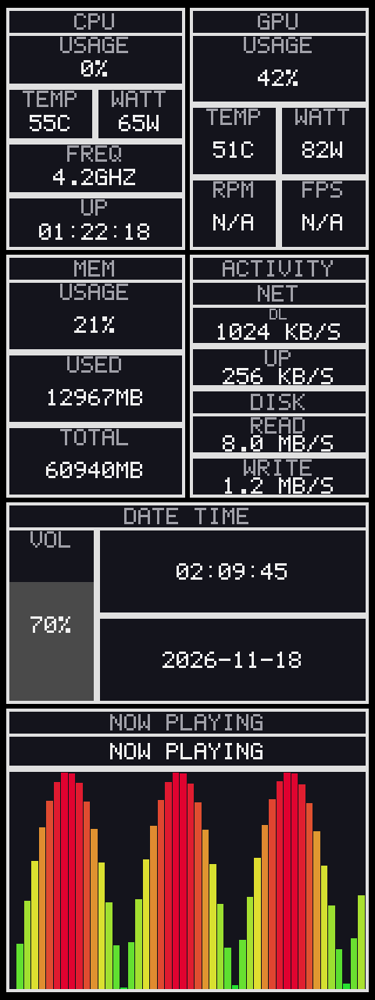

# trofeo_lcd

**English** · [Bahasa Indonesia](./README.id.md)

**A lightweight, open-source alternative to the official Thermalright TRCC
software.** This project uses a **6-inch Thermalright LCD**, **1280×480**,
with USB HID ID `0416:5302`. The earlier **9.16-inch Trofeo Vision**
(1920×462, USB bulk LY `0416:5408` / `0416:5409`) is also supported.
The USB protocols are based on [thermalright-trcc-linux](https://github.com/Lexonight1/thermalright-trcc-linux).

The **default view is a grid dashboard** that packs everything into panels
at a glance — CPU, GPU, RAM, network & disk activity, date/time/volume and
a now-playing visualizer. It fills the screen in either orientation:

**Landscape** (`--rotate 0` or `180`, 1280×480):



**Portrait** (`--rotate 90` or `270`, 480×1280):



Pass **`--classic`** to use the old adaptive views instead — the display
**adapts automatically to what your computer is doing**, no manual
switching needed:

**Idle** — audio is quiet, so the EQ bars are low and the top bar shows
system info: CPU usage & real-time frequency, RAM, uptime, clock and date.


**Media** — a song is playing: the stripes follow the music, and the top bar
shows the now-playing track (title/artist/album from the media controls).


**Gaming** — a game is in the foreground: game info is detected and the
system status (CPU/GPU/RAM/temp) stays readable while playing.


## Features

- **Grid** shows system, media and disk activity. **Inference** adds a dedicated
  dashboard for [InferRig](https://github.com/solverit/inferrig), the local llama.cpp control plane.
- Both executables detect LY and supported HID JPEG panels at startup.
- EQ bars (48) from currently playing audio (WASAPI loopback on Windows,
  PulseAudio/PipeWire on Linux, Core Audio process tap on macOS), colored
  green→yellow→red. Can be turned off entirely with `--no-audio`.
- Optional **background image** (`--background`), with the text color picked
  per line to stay readable on light photos.
- System info: CPU %, real-time CPU frequency, RAM, uptime, clock & date.
- Can also drive a **DeepCool** display (sends CPU data over HID).
- **Second monitor mode** (`trofeo_screen`): the LCD becomes a real second
  monitor.
- Sync EQ bar color with an **OpenRGB** device.
- Adaptive FPS: drops to idle when silent → saves CPU.

## Usage

```bash
cargo build --release
./target/release/trofeo_lcd      # Windows: .\target\release\trofeo_lcd.exe
```

**Windows** — to read AMD CPU temp/power, install
[PawnIO](https://github.com/namazso/PawnIO) and run as Administrator.

**Linux** — run `sudo bash scripts/root-setup.sh` for USB permissions and
Debian/Ubuntu build dependencies. Install `playerctl` for song titles. Add
`--rapl` to grant the invoking user CPU package energy access through the
`trofeo-rapl` group, then log out and back in. Unavailable power readings show `N/A`.

**macOS** — no extra install needed: system audio comes from a Core Audio
process tap (native since 14.2, no virtual driver and no permission prompt).
Run as `root` only if you want CPU power + real-time frequency; without it
those two fields show `N/A` and everything else works.

## Profiles and configuration

`trofeo_lcd` reads `$XDG_CONFIG_HOME/trofeo-lcd/config.json` (default
`~/.config/trofeo-lcd/config.json`) on Linux/macOS or
`%APPDATA%/trofeo-lcd/config.json` on Windows. Every field is optional.
CLI flags override the file. Unspecified values come from the selected profile.

| Profile | Theme | Audio | Idle / active FPS |
|---|---|---|---|
| `grid` (default) | `standard` | on | 2 / 15 |
| `inference` | `terminal` | off | 3 / 15 |
| `classic` | `standard` | on | 2 / 15 |

[Rendered inference dashboard in landscape](img/inference_landscape.png) · [Portrait](img/inference_portrait.png)

The `monitor` theme shows the active InferRig profile, its run uptime and context
occupancy above eight one-minute charts. GPU metrics occupy the first row.
APU power, CPU load, system RAM and combined network RX + TX occupy the second.
The values and history come from `/api/status-board` on the configured InferRig
host. A dash indicates a missing reading. Run
`trofeo_lcd --config examples/monitor.json` to select this layout.

[Monitor theme preview (1280 × 480)](img/monitor_landscape.png)

| JSON key | Accepted values | Effect |
|---|---|---|
| `profile` | `"grid"`, `"inference"`, `"classic"` | Select the system grid, the InferRig dashboard, or the adaptive EQ, clock and game views. |
| `theme` | `"standard"`, `"terminal"`, `"monitor"` | Use neutral or green accents, or select the eight-chart monitor layout with the inference profile. |
| `idle_fps` | Number greater than 0 | Target frame rate during silence or whenever audio capture is off. |
| `active_fps` | Number greater than 0 | Target frame rate when audio capture detects sound. |
| `audio` | `true`, `false` | Enable or disable system audio capture. |
| `inferrig_url` | URL string | Base address of the InferRig API used by the `inference` profile. Defaults to `http://127.0.0.1:5577`. |
| `net_peak_half_life_secs` | Number ≥ 0, in seconds | In the local system panels of the `inference` profile, a network peak halves over this interval. The default is 2. Set to 0 to show current transfer rates. |

Unknown keys cause a configuration error. To use all InferRig defaults, the entire file can be `{"profile": "inference"}`.

Example configuration for the InferRig display:

```json
{
  "profile": "inference",
  "theme": "terminal",
  "idle_fps": 3,
  "active_fps": 15,
  "audio": false,
  "inferrig_url": "http://127.0.0.1:5577",
  "net_peak_half_life_secs": 2
}
```

Run `trofeo_lcd --config examples/inference.json` to try the example, or
copy it to the user configuration path. The supplied systemd user unit uses
this same configuration and the executable installed by `cargo install --locked --path .`.

## Main options

| Option | Purpose | Default |
|---|---|---|
| `--config <PATH>` | Read dashboard settings from this JSON file | user configuration path above |
| `--profile <NAME>` | Select `grid`, `inference` or `classic` | `grid` |
| `--theme <NAME>` | Select `standard`, `terminal` or `monitor` | profile default |
| `--idle-fps <N>` / `--active-fps <N>` | Target FPS during silence / sound | profile default |
| `--silence-threshold <N>` | Peak audio amplitude below which the input counts as silent | `0.005` |
| `--silence-timeout-ms <N>` | Continuous silence before switching to idle FPS, in milliseconds | `800` |
| `--color <MODE>` | Override the accent with a named color, `#RRGGBB` or `R,G,B` | `default` |
| `--openrgb-poll-ms <N>` | OpenRGB color polling interval in milliseconds | `300` |
| `--background <PATH>` | Show a PNG/BMP/JPEG image behind the text (cropped to fit) | off |
| `--background-dim <0-100>` | Darken that image once at load so the text stays readable — free, no per-frame cost | `15` |
| `--rotate <DEG>` | Rotate the screen: 0, 90, 180 or 270 | `0` |
| `--classic` | Use the classic adaptive views (EQ bars / idle clock / game dashboard) instead of the grid dashboard | grid dashboard |
| `--audio` / `--no-audio` | Enable / disable audio capture | profile default |
| `--inferrig-url <URL>` | Base URL of the InferRig API for the AI INFERENCE panel | `http://127.0.0.1:5577` |
| `--no-inferrig` | Hide the AI panel and give its space to the system panels | panel enabled in `inference` |
| `--hid-rotate <DEG>` | Override the HID panel's wire rotation (0/90/180/270) if the picture ever comes out rotated | from handshake |
| `--no-deepcool` | Turn off DeepCool integration | enabled |
| `--deepcool-update-ms` | DeepCool send interval (100–2000 ms) | `1000` |
| `--openrgb-device <NAME>` | Sync color with an OpenRGB device | disabled |
| `--hide-console` | Hide the console window (Windows) | disabled |
| `-h, --help` | Show command-line help | — |
| `-k, --screenshot-key` | Global hotkey to save the current LCD frame as a screenshot — **lossless PNG** (deflate-compressed, so still pixel-perfect; a flat screen ~10 KB instead of 2.6 MB raw) (f1-f12, printscreen) | off |

## Second monitor mode

Run **`trofeo_screen`** (instead of `trofeo_lcd` — they share the LCD, so
don't run them together):

```bash
./target/release/trofeo_screen --list-displays    # list monitors
./target/release/trofeo_screen                    # stream to LCD
```

Requires a *Virtual Display Driver* (VDD) at the LCD resolution (1280×480 for the 6-inch model) — see
**[GUIDE_SECOND_MONITOR.md](./GUIDE_SECOND_MONITOR.md)**.

## Structure

- `src/lib.rs` — USB driver: handshake, chunking, JPEG encode, `Framebuffer`.
- `src/audio.rs` — audio capture (WASAPI / PulseAudio-PipeWire / Core Audio tap).
- `src/cpu_sensor.rs`, `src/cpu_freq.rs` — CPU temp/power & frequency.
- `src/deepcool/` — DeepCool display drivers (HID).
- `src/dxgi_capture.rs` + `src/bin/screen.rs` — second monitor mode.
- `src/main.rs` — main loop: audio → FFT → EQ bars → send to screen.
- `src/background.rs` — background image decode, dimming & text contrast.
- `src/jpeg_decode.rs` — JPEG decoder (baseline + progressive), written from
  scratch to avoid pulling in the `image` crate.
- `src/audio_macos.rs`, `src/smc_macos.rs`, `src/amd_pm_macos.rs`,
  `src/amd_gpu_macos.rs` — macOS backends (see `src/media.rs` & `src/netdisk.rs`
  for the volume and network/disk paths).

## Performance

Measured on a Windows PC (12 logical processors), running `trofeo_lcd` at
default settings (idle FPS 2 / active 15, DeepCool enabled):

| Metric | Measured |
|---|---|
| RAM | ~13 MB working set (stable, no growth) |

It stays this light thanks to adaptive FPS (JPEG encode + USB transfer only
happen while there is audio) and the CPU optimizations in `src/main.rs` /
`src/lib.rs`.

## License

GPL-3.0-or-later (follows the referenced upstream project).